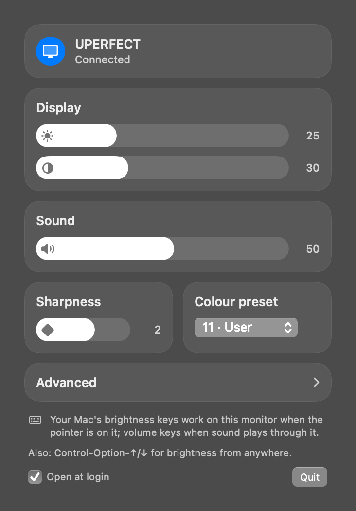

# Monitor Bar

A small macOS menu-bar app (and a command-line tool) that controls an external monitor's own
settings (brightness, contrast, volume, sharpness, colour) from the Mac, over DDC/CI. Built for a
**UPERFECT 4K OLED portable monitor** whose buttons stopped working, so its on-screen menu
couldn't be reached.



## What it does

- **Menu-bar panel** in the style of Control Center: brightness, contrast, volume, sharpness and
  colour preset; under *Advanced*, red/green/blue gain and the monitor's factory resets (each
  asks "are you sure?" first).
- **An "off" step below brightness 0:** the monitor shows pure black (on an OLED, its pixels are
  off) while staying on. Reach it with brightness-down at 0 or by dragging the slider past its
  left end; brightness-up, the slider, or a click on the black screen brings the picture back.
  It's a black window, not a power-off, so quitting the app or unplugging the monitor also ends it.
- **The menu-bar icon shows the monitor's brightness,** and hides itself while the monitor is
  unplugged.
- **Your Mac's own keys:** the brightness keys change the monitor when the pointer is on it
  (the built-in screen keeps its keys), and the volume and mute keys change the monitor's speaker
  volume when sound is playing through it, which macOS can't do itself. A small pill shows the
  new level. Option-Shift gives quarter steps, as with Apple's own screens.
- **Control-Option-↑/↓** change the monitor's brightness from anywhere, with no permissions.
- **Opens at login** (a checkbox in the panel).
- **`monitorctl`**, a command-line tool sharing the same core, for scripts and the terminal.

It reads the monitor when the panel opens, never on a timer, sends slider changes at most a few
times a second, and treats "monitor not found" as a normal, temporary state: the control channel
disappears for a few seconds whenever the display reconnects or changes mode, and the app
reconnects by itself.

## Requirements

- An **Apple Silicon** Mac. It reaches the monitor through private IOKit functions
  (`IOAVServiceCreateWithService`, `IOAVServiceReadI2C`, `IOAVServiceWriteI2C`), so it isn't
  sandboxed and can't go on the App Store.
- **macOS 14** or later. Developed on macOS 27.
- A monitor that speaks **DDC/CI** over USB-C/DisplayPort. Only the UPERFECT 4K OLED (Realtek
  controller) has been tested; other monitors may answer different codes, or none.
- The **Command Line Tools** (`xcode-select --install`). Xcode isn't needed.

## Build and install

```sh
./build.sh            # build the app into build/ and monitorctl into bin/
./build.sh --install  # build, then move the app into ~/Applications and open it
```

Nothing is replaced until the whole build succeeds. To use the command-line tool from anywhere:

```sh
ln -s "$PWD/bin/monitorctl" /usr/local/bin/monitorctl
```

### Signing, and why permissions can "forget" the app

The brightness and volume keys need **Accessibility** permission. macOS ties that permission to
the app's code signature, and an ad hoc signature changes with every build, so each rebuild would
need the permission granted again. `build.sh` therefore signs with a certificate called
**"Monitor Bar Local Signing"** if your login keychain has one, and falls back to ad hoc signing
if not. To make a private, self-signed one (it never leaves your Mac):

```sh
cat > /tmp/cfg <<'CFG'
[req]
distinguished_name = dn
prompt = no
x509_extensions = ext
[dn]
CN = Monitor Bar Local Signing
[ext]
basicConstraints = critical,CA:false
keyUsage = critical,digitalSignature
extendedKeyUsage = critical,codeSigning
CFG
/usr/bin/openssl req -x509 -newkey rsa:2048 -nodes -days 3650 -config /tmp/cfg -keyout /tmp/key.pem -out /tmp/cert.pem
/usr/bin/openssl pkcs12 -export -inkey /tmp/key.pem -in /tmp/cert.pem -out /tmp/id.p12 -passout pass:temp -name "Monitor Bar Local Signing"
security import /tmp/id.p12 -k ~/Library/Keychains/login.keychain-db -P temp -T /usr/bin/codesign
rm /tmp/cfg /tmp/key.pem /tmp/cert.pem /tmp/id.p12
```

Keep only **one copy** of the app. With two copies of the same identity (say, a `build/` copy
left by `./build.sh --run`), macOS can tie the Accessibility switch to the wrong one: the switch
shows as on, but the keys don't work and the app keeps asking. To fix it, delete the extra copy,
run `tccutil reset Accessibility uk.co.instadesign.monitor-bar`, and allow the app again.

## monitorctl

```
monitorctl status                 show the current settings
monitorctl <setting>              show one setting
monitorctl <setting> <value>      set it (a number, or +10 / -10 to step)
monitorctl get <code>             read any setting by its hex code, e.g. get 10
monitorctl set <code> <value>     write any setting by its hex code
monitorctl scan                   list every code the monitor supports (takes ~30 s)
monitorctl reset <what> --yes     factory reset: all, brightness, geometry or colour
monitorctl save                   ask the monitor to store the current settings
```

Settings: `brightness`, `contrast`, `volume`, `sharpness`, `preset`, `red`, `green`, `blue`,
`language`, `osd`, `power`.

## Handle with care

If your monitor's buttons don't work, some changes can't be undone from the monitor itself:

- **Power mode (code D6) set to standby or off** turns the monitor off, and only unplugging and
  replugging it brings it back.
- **A full factory reset** (`monitorctl reset all --yes`, or *Reset everything* in the panel) can
  change settings that only the monitor's own menu can set back. On the UPERFECT it reset
  brightness, volume and colour; the panel can set those again.
- **Manufacturer codes (E0–FF) do unknown things**. Don't write to them blind.

## How it works

The app finds the external display's `DCPAVServiceProxy` entry in the I/O Registry and talks
DDC/CI to it over I²C (chip address `0x37`, data address `0x51`). A read sends
`82 01 <code> <checksum>`, waits about 60 ms and reads 11 bytes back; a write sends
`84 03 <code> <hi> <lo> <checksum>`. This monitor's Realtek controller wants the read checksum
seeded with `0x6E` rather than the standard `0x6E ^ 0x51`; the code tries both. Every packet is
sent twice, 15 ms apart, as other DDC tools do.

The code is in `Sources/`:

| Part | What it is |
|---|---|
| `MonitorCore` | The DDC/CI protocol: find the monitor, read and write settings. |
| `monitorctl` | The command-line tool. |
| `MonitorBar` | The menu-bar app (SwiftUI panel, key handling, login item). |

Built with the Command Line Tools only, so SwiftUI's `@State` (whose macro plug-in ships only
with Xcode) isn't used; view state lives in `MonitorModel`. Apple's own brightness/volume bubble
can't be shown by other apps on macOS 27, so the app draws its own.

## Credits

[MonitorControl](https://github.com/MonitorControl/MonitorControl) (MIT) showed how to reach
DDC/CI on Apple Silicon through `IOAVService`.

## Licence

MIT. See [LICENSE](LICENSE).
